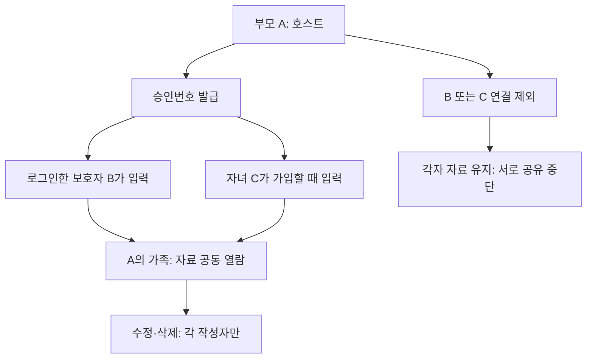

# UI76 — 개인 자료와 부모 호스트 가족 연결

로그인 아래 회원가입 버튼. 자녀 가입은 ID(영문/숫자/밑줄 4~20자), 이름, 비밀번호(8자 이상), 부모 승인번호를 요구한다. 유효한 번호가 없으면 계정이 생성되지 않는다. 보호자는 기존 이메일/Google 로그인을 사용한다.

|행동|개인|연결된 보호자·자녀|부모 호스트|
|---|---|---|---|
|본인 일정·반복·학원비·기록·대화 작성/수정/삭제|가능|가능|가능|
|연결된 가족 자료 열람|불가|가능|가능|
|다른 작성자 자료 수정/삭제|불가|불가|불가|
|승인번호 발급|부모만 가능: 발급하면 호스트|불가|가능|
|구성원 연결 제외|해당 없음|불가|가능|

하나의 활성 가족만 허용한다. 다른 가족에 합류하려면 기존 연결을 먼저 해제한다. 연결된 보호자는 그 가족 안에서 추가 하위 가족을 만들 수 없다. 번호 발급자는 항상 부모 호스트이며 자녀는 번호를 발급할 수 없다.

번호는 6자리, 한 사람 1회, 15분이다. 재발급 시 이전 미사용 번호는 폐기한다. 가족에서 누군가 제외되거나 나가면 미사용 번호도 무효화한다. 별도 운영자 승인은 없다. 여기서 부모는 보호자 계정과 공유 동의에 따른 역할이며 법정 친자관계를 증명하는 외부 신원 심사가 아니다.

자료는 가족 ID가 아닌 작성 프로필 UUID에 귀속된다. 공유 여부는 매 요청 시 활성 연결로 계산한다. 호스트도 타인 자료를 변경할 수 없다. 가족 해제는 자료를 삭제하지 않는다. 자녀도 제외 후 기존 ID/비밀번호로 로그인하고 개인 자료를 계속 사용할 수 있다. 삭제는 soft delete, 수정/삭제는 version으로 충돌을 차단한다. 클라이언트 작성자 위조는 거부한다.

서버는 HttpOnly 세션, Origin 검사, 호출 제한을 적용한다. app_runtime은 원본 테이블 직접 접근이 없으며 고정 search_path의 정책 함수만 실행한다. 모든 새 테이블에 FORCE RLS를 적용한다. 예전 자녀가 번호를 발급하던 공개 API는 410으로 종료한다. 이전 고급 화면/테스트는 legacy=1 경로로 유지하며 새 기본 개인 자료 API와 분리한다.

기존 운영 DB의 일정/자녀/자녀계정 수가 모두 0임을 사전 읽기 조회로 확인했다. 작성자를 추정하여 이전 자료를 다른 사람에게 귀속시키는 이관은 하지 않는다. 기존 성인 로그인은 유지된다.

검증: API/정책 통합 테스트에 개인 CRUD, A/B/C 공유, 호스트의 타인 수정 거부, 제외 후 자녀 재로그인, 번호 만료/재사용/역할/Origin/RLS 검사를 포함한다. 실제 PostgreSQL에 동시 번호 소비 1승자 검사를 추가한다. 브라우저에서는 개인 일정 → 부모 번호 → 자녀 가입 → 공유 → 제외 흐름과 320/390/768/1440px 화면을 검사한다.
